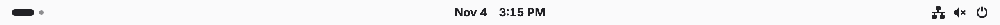
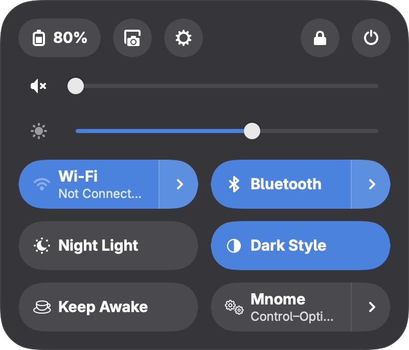
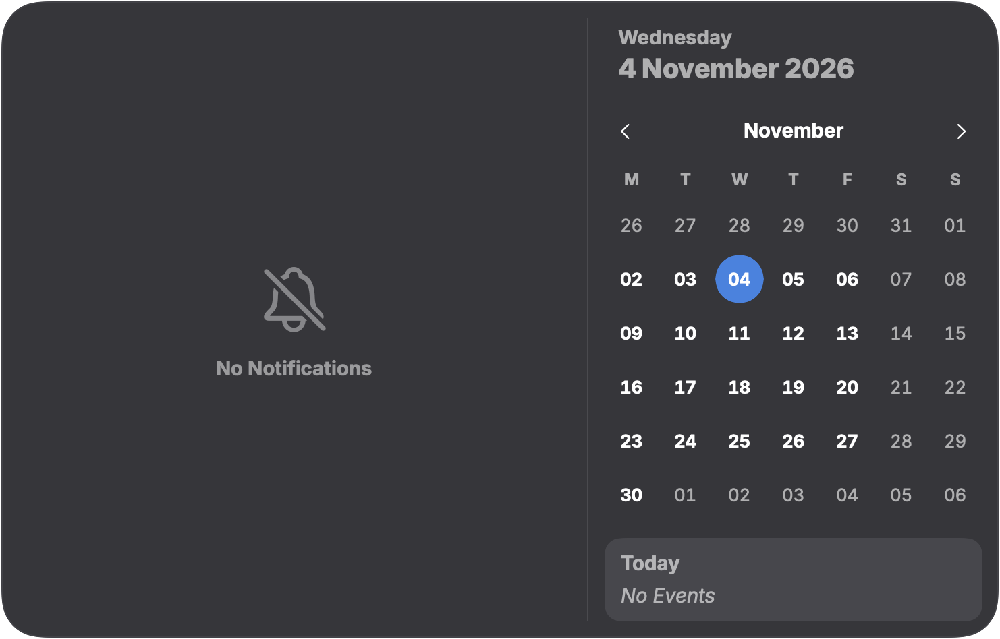
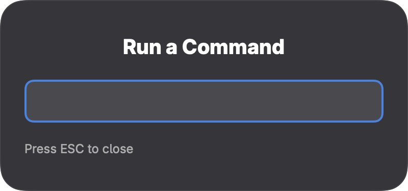

# Mnome

**GNOME Shell on macOS, with SIP on.** Mnome replaces the Mac's menu bar, Dock, Mission Control and desktop with GNOME's top bar, overview, app grid, workspaces and keyboard shortcuts. It is a normal app: quit it and the Mac comes back exactly as it was.


Apple Silicon, macOS 15 or later (built and tested on macOS 27). Swift/AppKit host, Rust core.

## What it does

### Top bar

- GNOME's 32-point bar on every display, in Adwaita Sans with Adwaita's symbolic icons, light or dark.
- **Activities** on the left: one dot per workspace, the current one a wide pill; a click toggles the overview.
- **Clock** in the centre, in GNOME's format and your locale; a click (or Super+V) opens the calendar with the day's events from Calendar.
- **Status pill** on the right (network, volume, battery) opens **Quick Settings**: screenshot, System Settings, lock, power menu, volume and brightness sliders, Wi-Fi, Bluetooth, Night Light, Dark Style, Keep Awake and Mnome's own settings.
- Power menu as GNOME's: Restart, Power Off and Log Out ask first and act after 60 seconds.
- The volume, mute and brightness keys show GNOME's level pill instead of the Mac's.
- **Run a Command** (Option+F2): an app's name opens it, anything else runs in your shell, `r` restarts Mnome.
- Or keep the Mac's own menu bar with Mnome's Activities, date and status pill in it (Preferences → Shell → Panels).

### Overview and app grid

- Windows glide from where they are onto the workspace, drawn on your wallpaper, with the next workspace peeking in; all Core Animation layers on the GPU.
- Click a window to go to it, drag it onto another workspace to move it, hover for its title and a close button.
- Type to search apps, open windows, System Settings panes, files (Spotlight) and sums (Return copies the answer).
- **App grid** in pages (Super+A), with GNOME's **folders**: drop an app on another to make one, rename it, drag apps out.
- Opens from Right Command, the Activities dots, the hot corner, Ctrl+↑, three fingers up, or Control–Option–Space.

### Windows and workspaces

- A window manager with a Rust core: it decides where windows belong, Swift carries it out and reads every move back.
- **Workspaces**: windows of other workspaces are parked out of sight, saved to disk first, so none is ever lost (even after a crash).
- Switching **slides** the screen as GNOME does; a row of dots shows where you are.
- **Edge tiling**: drag a window to an edge for half the screen, a corner for a quarter, the top to maximize; an accent preview shows where it goes, and dragging away gives its size back.
- Dragging the edge two tiles share resizes both.
- **Hot corner**: push the pointer into the top-left corner for the overview.
- **Alt+Tab / Super+Tab** application switcher; the key above Tab cycles one app's windows.
- Typing never reaches a hidden window; focus follows you when you choose an app from the Dock or Cmd+Tab.

### Trackpad

- Three fingers up open the overview, then the app grid; down go back; sideways switch workspace.
- The overview and the workspace slide follow your fingers; let go past half way, or flick, to finish.
- The Mac's own three-, four- and five-finger swipes are off while Mnome runs, so nothing fights.

### The Mac, replaced or adapted

- **Only Mnome** (on by default) turns off the Dock, menu bar, desktop icons and widgets, Stage Manager, Mission Control, hot corners, window animations and edge tiling while Mnome runs. Preferences → Shell picks each one.
- **Mnome's desktop**: the wallpaper behind every app; right click for Change Background, Display Settings and Settings.
- **The Mac's own Dock**, if you keep it: Mnome adds GNOME's **Show Applications** after the separator, and in the overview the Dock slides up as the overview's dash.
- Ctrl+↑ and Ctrl+↓, the Mac's Mission Control keys, open Mnome's overview and app grid.
- Mnome warns when a display has more than one Mac desktop (Space) and helps remove the extras.

### Safe to try

- Everything Mnome changes on the Mac is saved first and put back when it quits.
- After a crash: relaunch and quit Mnome, or run `build/Mnome.app/Contents/MacOS/Mnome --rescue`.
- **Bring Back All Windows** (status menu, Preferences → Shell) returns every parked window at once.
- Nothing needs SIP off, a kernel extension or code injected into other apps.

## Screenshots

| Top bar (dark) | Top bar (light) |
|---|---|
|  |  |

| Quick Settings | Calendar | Run a Command |
|---|---|---|
|  |  |  |

## Keyboard

Right Command is **Super** (Preferences → Keyboard can make it Right Option). Only the combinations below are taken; everything else, and all of Left Command, reaches your apps.

| Keys | Does |
|---|---|
| Super (tap) | Open or close Activities |
| Super+A | App grid |
| Super+S / Super+V | Quick Settings / calendar |
| Super+L | Lock screen |
| Super+←/→, Super+↑/↓ | Tile left/right, maximize/restore |
| Super+H, Super+D | Minimize, show desktop |
| Option+F4 | Close window |
| Super+Option+←/→ | Previous / next workspace |
| Super+Option+Shift+←/→ | Move the window to the previous / next workspace |
| Super+Home / End | First / last workspace |
| Option+Tab, Super+Tab | Switch applications |
| Option+Esc | Next window |
| Option+F2 | Run a Command |
| Ctrl+↑ / Ctrl+↓ | Overview / app grid |

The full list is in Mnome's **Keyboard Shortcuts** window.

## Install

You need Xcode and Rust.

```sh
cargo fetch --manifest-path core/Cargo.toml   # once, the build is offline
./scripts/build.sh                            # makes build/Mnome.app
open build/Mnome.app
```

Grant **Accessibility** (window control, shortcuts) and **Screen Recording** (window pictures, the workspace slide) in System Settings → Privacy & Security. Apps still launch without them.

An ad-hoc signed build may ask for the permissions again after each rebuild. To keep them, create a self-signed *Code Signing* certificate in Keychain Access and build with `MNOME_SIGN_ID="<certificate name>" ./scripts/build.sh`.

## Known limits

- The Apple menu can't be replaced; in the Mac menu bar mode, the Mac's clock and Control Center icon can't be hidden either.
- Native full-screen windows are left alone; Stage Manager and Mnome's workspaces don't mix (workspaces pause while it is on).
- Three-finger drag (an Accessibility setting) takes three-finger swipes; turn it off for Mnome's gestures.
- Window pictures are snapshots, not live video.
- Mnome uses a few private macOS calls (trackpad, Spaces, Dock auto-hide), looked up at runtime; each has a fallback if a macOS update removes it.

## Development

```sh
cargo fmt --manifest-path core/Cargo.toml --check
cargo clippy --manifest-path core/Cargo.toml --offline --all-targets -- -D warnings
cargo test --manifest-path core/Cargo.toml --offline
cargo build --release --manifest-path core/Cargo.toml --offline && swift test
./scripts/build.sh && build/Mnome.app/Contents/MacOS/Mnome --self-test
./scripts/live-tests.sh        # drives the real Mac for ~4 minutes
```

`Mnome --gallery DIR` renders the panels to PNG without opening windows (the pictures above come from it).

More: [how each part works](docs/GUIDE.md), [the Rust core](core/README.md), [UI guide](docs/UI-GUIDE.md).
