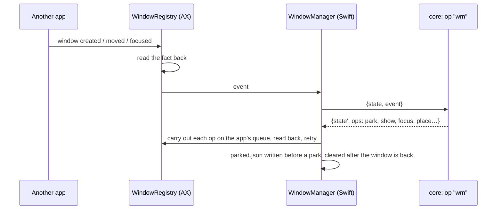

# How Mnome is built

Mnome is one macOS app (`build/Mnome.app`) made of two parts.

- **The core** (`core/`, Rust, about 2,800 lines) is stateless: it is handed a request in JSON and answers in JSON, through a small C ABI (`mnome_process` / `mnome_free`, see [`core/README.md`](../core/README.md)). It ranks app searches (`search`), lays out the overview (`layout`), places the dash (`dock`), moves the switcher's selection (`navigate`), and decides where every window belongs (`wm`, `wm_hit`).
- **The host** (`Sources/`, Swift, about 7,200 lines) does everything that touches macOS: Accessibility, events, windows, drawing, settings.
  - `Sources/MnomeSupport/`: pure logic with no AppKit, unit-tested in `Tests/` (layouts, the window protocol, parking corners, gestures, shortcuts, the bar's layout, Mac settings snapshots…).
  - `Sources/Mnome/Platform/`: the edges with macOS: `AXClient` (one serial queue per app, a 1-second timeout, an app that hangs is left alone for a while), `WindowRegistry` (Accessibility notifications, read-back, the 30-second sweep), `EventTap` (keys), `Multitouch` (trackpad), `Private` (private calls, below).
  - `Sources/Mnome/Shell/`: the window manager, overview, switcher, menus, gestures, desktop, slide.
  - `Sources/Mnome/`: the top bar, the app menus and icons, Mac settings, the app delegate (`main.swift`), and the checks (`--self-test`, `--system-check`, `--engine-check`, `--key-check`, `--overview-check`).

## Window flow

The core keeps no state between calls: Swift hands it the whole state with each event and stores what comes back.

A key press goes the same way: `EventTap` → `KeyRouter` (MnomeSupport) → a `WMEvent` such as `stepWorkspace` or `snap` → the core.

## Private and undocumented calls

Each is looked up at run time (`dlsym`), so a macOS that drops one loses only that feature; none is needed to start.

| Call | From | For | Without it |
|---|---|---|---|
| `_AXUIElementGetWindow` | ApplicationServices | joining an Accessibility window to its window-server number | the window gets a made-up number: it is still managed, but has no picture and no place in the window order |
| `SACLockScreenImmediate` | login | Lock in Quick Settings, Super+L | nothing happens (logged) |
| `DisplayServicesGet/SetBrightness` | DisplayServices | the brightness slider and keys | the Mac's own brightness keys |
| `SLSGet/SetAppearanceThemeLegacy` | SkyLight | Dark Style | the toggle is greyed out |
| `SLSMainConnectionID`, `SLSCopyManagedDisplaySpaces` | SkyLight | counting Mac desktops (Spaces) per display | no extra-Spaces warning |
| `CoreDockGet/SetAutoHideEnabled` | ApplicationServices | the Mac Dock sliding up in the overview | the Dock stays as it is |
| `IOBluetoothPreferenceGet/SetControllerPowerState` | IOBluetooth | the Bluetooth toggle | the toggle is greyed out |
| `CBBlueLightClient` | CoreBrightness | Night Light | the toggle is greyed out |
| `MTDeviceCreateList`, `MTRegisterContactFrameCallback`, … | MultitouchSupport | three-finger gestures | no gestures (logged) |
| `CGEventPostToPid` to MenuBarAgent | public call, private target | clicking an app's menu bar icon | the icon shows, a click does nothing |

Pictures use ScreenCaptureKit (`SCScreenshotManager`), the public API: window pictures, the workspace slide, and the apps' menu bar icons, cut from the hidden Mac menu bar that MenuBarAgent draws.

## Mac settings

Every setting Mnome changes is a `MacElement` (`Sources/MnomeSupport/MacChromeSupport.swift`): a list of preference keys with the value that hides the part, and the process to restart (Dock, Finder, WindowManager, ControlCenter). Before the first change the original values are saved (`macChromeSnapshot` in Mnome's defaults); they are put back on a normal quit, at the next launch after a crash, by Restore All, and by `--rescue`. A `@currentHost` suffix writes the per-Mac layer, which macOS 27 reads for trackpad gestures and menu bar icons.

| Element | What it changes |
|---|---|
| Dock | Dock auto-hide with a very long delay |
| Menu bar | `_HIHideMenuBar` |
| Desktop | Finder's desktop, widgets |
| Stage Manager | Stage Manager, click to show desktop |
| Mission Control | Mission Control, App Exposé, Launchpad and show-desktop gestures; three-, four- and five-finger swipes |
| Hot corners | all four corners to no action |
| Animations | window open and resize animations, the Dock's launch bounce |
| Tiling | macOS edge and top tiling, the Option accelerator |
| Status icons | Wi-Fi, Bluetooth, Sound, Battery, Display, Screen Mirroring, user, Now Playing, Focus; the clock's date |

The Mac Dock's Show Applications tile is written to the Dock's `persistent-others` and removed on quit.
